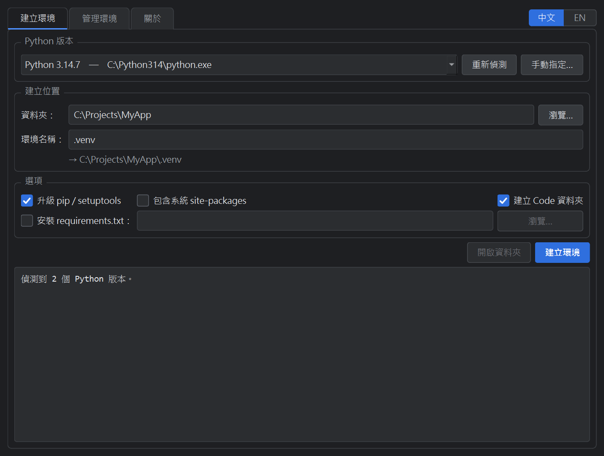
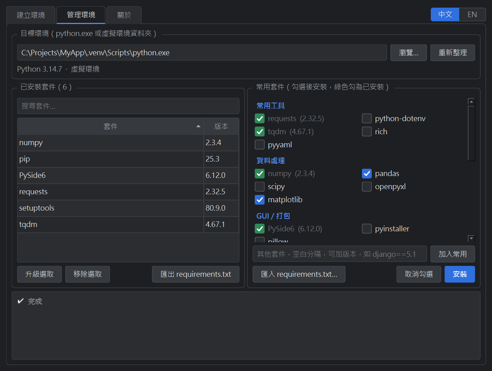
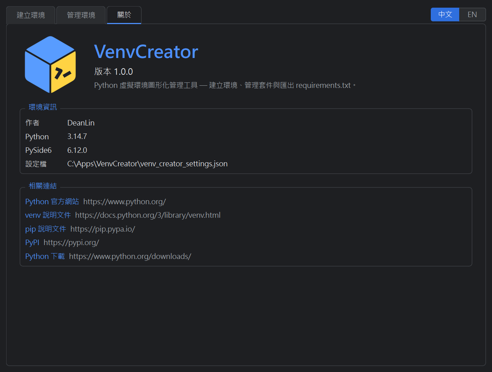
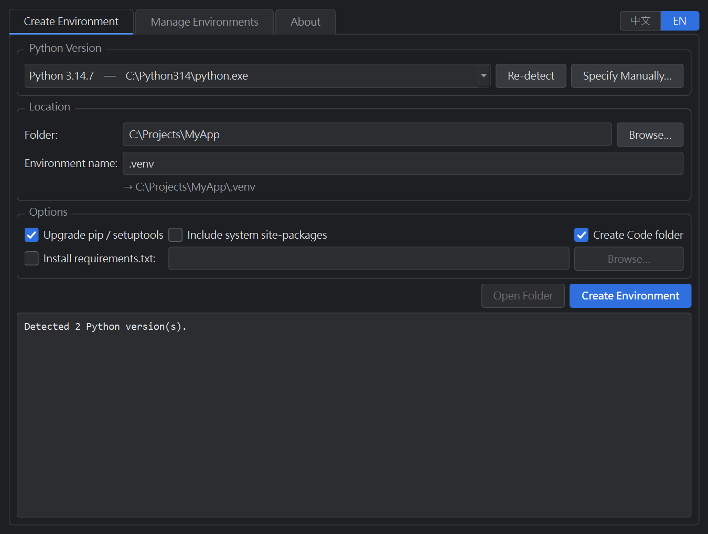
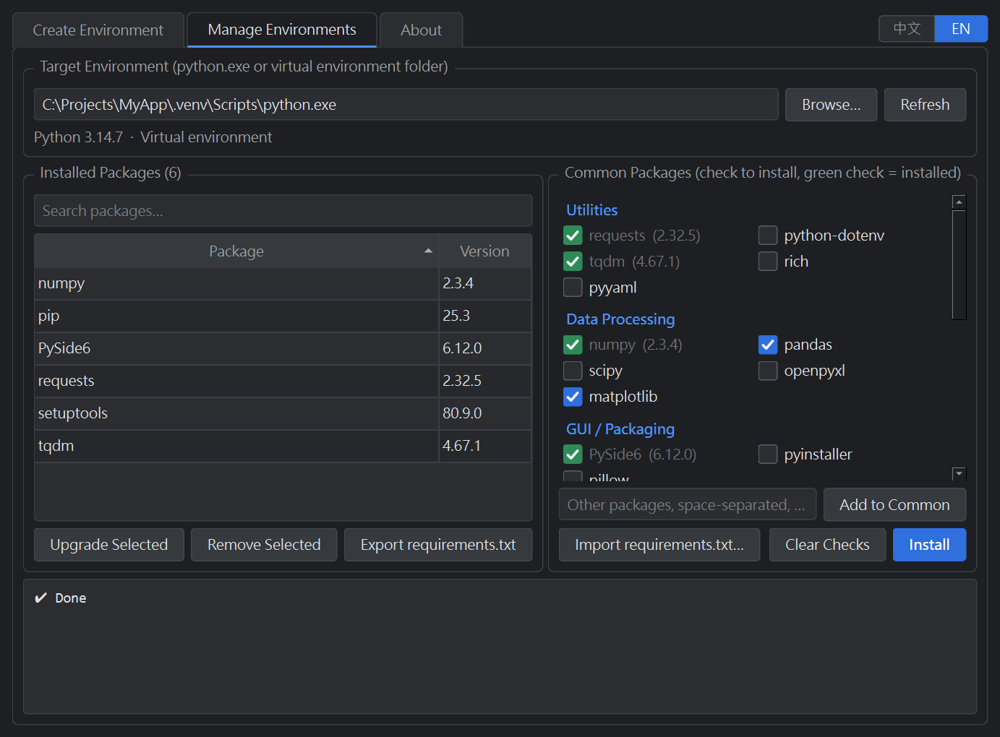
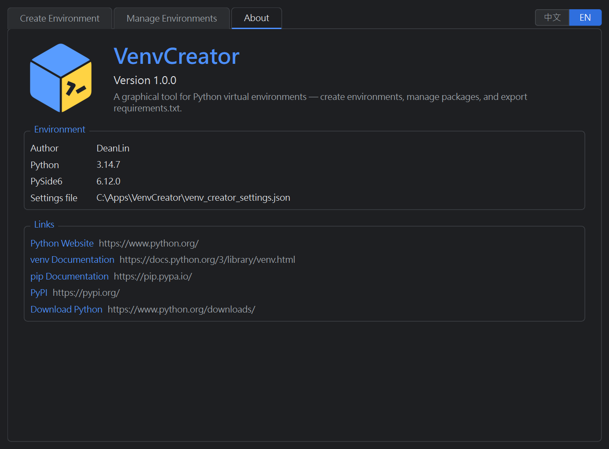

# VenvCreator

[繁體中文](#繁體中文) | [English](#english)

---

## 繁體中文

VenvCreator 是 Python 虛擬環境的深色模式圖形化管理工具，以 Python 與 PySide6 開發，可以在同一個視窗中建立虛擬環境，並管理環境內的 pip 套件。

### 功能

- **建立環境**：自動偵測系統上已安裝的 Python 版本，也可手動指定 python 執行檔；可選擇建立位置與環境名稱。
- **建立選項**：升級 pip / setuptools、包含系統 site-packages、建立 `Code` 資料夾，以及安裝 `requirements.txt`。
- **管理環境**：選擇 `python.exe` 或虛擬環境資料夾，列出已安裝套件，可搜尋、升級、移除，並匯出 `requirements.txt`。
- **常用套件**：依分類勾選安裝，已安裝的套件會以綠色勾號標示；可加入自訂套件，或從 `requirements.txt` 匯入。
- **記錄設定**：自動記住上次的建立選項、管理的環境與自訂套件。
- **介面語系**：在視窗右上角切換繁體中文 / English，立即生效。

### 畫面截圖

**建立環境**



**管理環境**



**關於**



### 系統需求

- Windows（主要平台）；程式內含 macOS / Linux 的處理，但尚未實測
- Python 3.10 以上
- PySide6

### 安裝與執行

```bash
git clone https://github.com/DeanLin0720/VenvCreator.git
cd VenvCreator
python -m venv .venv
.venv\Scripts\activate
pip install PySide6
python venv_creator.py
```

macOS / Linux 請改用 `source .venv/bin/activate` 啟用虛擬環境。

### 打包成執行檔

```bash
pip install pyinstaller
pyinstaller --noconfirm --onedir --windowed --name VenvCreator --icon logo\venv_creator.ico --add-data "logo;logo" venv_creator.py
```

產出的執行檔在 `dist\VenvCreator\VenvCreator.exe`，發布時請帶上整個 `dist\VenvCreator` 資料夾。macOS / Linux 的 `--add-data` 分隔符請改用冒號：`"logo:logo"`。

### 設定檔

設定會存在程式同目錄的 `venv_creator_settings.json`，包含上次的建立選項、管理的環境、自訂套件與介面語系。

### 授權

本專案採用 [MIT 授權](LICENSE)。

### 作者

DeanLin

---

## English

VenvCreator is a dark-mode desktop GUI for Python virtual environments, built with Python and PySide6. It lets you create virtual environments and manage their pip packages from one window.

### Features

- **Create Environment**: Detects installed Python versions automatically, or lets you specify a python executable, and lets you choose the location and environment name.
- **Creation options**: Upgrade pip / setuptools, include system site-packages, create a `Code` folder, and install from `requirements.txt`.
- **Manage Environments**: Choose a `python.exe` or virtual environment folder to list its installed packages, then search, upgrade, remove, or export them to `requirements.txt`.
- **Common Packages**: Check packages by category to install them, with installed packages marked by a green check. You can add your own packages or import them from `requirements.txt`.
- **Saved settings**: Remembers your last creation options, managed environment, and custom packages.
- **Interface language**: Switch between Traditional Chinese and English from the top-right corner; the change applies immediately.

### Screenshots

**Create Environment**



**Manage Environments**



**About**



### Requirements

- Windows (primary platform); the code includes macOS / Linux handling, but it has not been tested there
- Python 3.10 or later
- PySide6

### Install and Run

```bash
git clone https://github.com/DeanLin0720/VenvCreator.git
cd VenvCreator
python -m venv .venv
.venv\Scripts\activate
pip install PySide6
python venv_creator.py
```

On macOS / Linux, activate the virtual environment with `source .venv/bin/activate` instead.

### Build an Executable

```bash
pip install pyinstaller
pyinstaller --noconfirm --onedir --windowed --name VenvCreator --icon logo\venv_creator.ico --add-data "logo;logo" venv_creator.py
```

The executable is created at `dist\VenvCreator\VenvCreator.exe`. Distribute the entire `dist\VenvCreator` folder. On macOS / Linux, use a colon as the `--add-data` separator: `"logo:logo"`.

### Configuration

Settings are stored in `venv_creator_settings.json` next to the program, including your last creation options, managed environment, custom packages, and the interface language.

### License

This project is licensed under the [MIT License](LICENSE).

### Author

DeanLin
